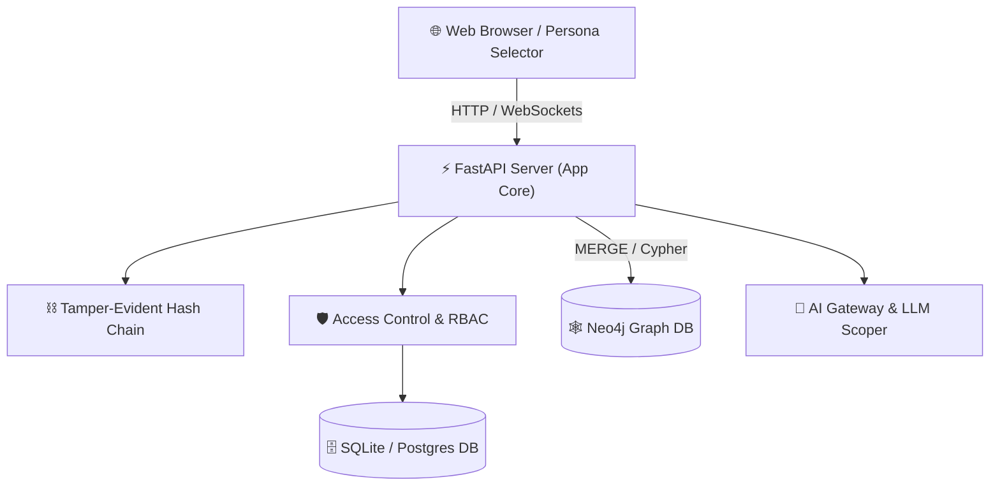

# CritX — Provenance-First Student–Industry Collaboration

[](https://github.com/rzoshan46-del/CritX/actions/workflows/ci.yml)
[](LICENSE)
[](https://www.python.org/downloads/)

> A cryptographic provenance platform establishing verifiable authorship, living charters, and mathematical payout splits for high-stakes student and industry R&D.

---

## The Problem
Industry sponsors struggle to outsource R&D challenges to students due to IP leakage, attribution disputes, and unverified AI generation. Students lack tamper-evident portfolios proving individual contributions on complex team projects.

## What Makes CritX Different
- **Project Sandbox & Watermarking:** Zero-width steganographic watermarks protect confidential briefs; leaks trace directly to viewer IDs.
- **AI Credits & Contribution Copilot:** Transparent AI declaration (`human`, `ai_assisted`, `agent_generated`) with similarity defense and automated scoping.
- **Neo4j Contribution Graph:** Multi-hop graph exploring connections between Users, Projects, Milestones, Contributions, Reviews, and Credentials.
- **Cohorts & Verified Profiles:** Cryptographic credentials with QR codes and verifiable SHA-256 chain anchors.
- **Living Charters:** Git-like versioned governance charters requiring explicit re-acceptance upon scope or rewards changes.
- **Exact Split Engine:** Mathematical payout distribution conserving exact integer currency without fractional leakage.

---

## System Architecture



---

## Screenshots

| Provenance Graph | Tamper-Evident Ledger |
| :---: | :---: |
|  |  |

---

## Tech Stack
- **Backend:** Python 3.11, FastAPI, Starlette, Uvicorn, Pydantic
- **Databases:** SQLite (local/embedded) with foreign keys, Neo4j 5 (graph engine)
- **Frontend:** Jinja2 server templates, Cytoscape.js 3.30.2, pure semantic CSS
- **Security & Cryptography:** itsdangerous, SHA-256 hash chains, zero-width steganography

---

## Quick Start

### 1. Windows PowerShell
```powershell
git clone https://github.com/rzoshan46-del/CritX.git; cd CritX
python -m venv .venv; .venv\Scripts\Activate.ps1
pip install -r requirements.txt
Copy-Item .env.example .env
uvicorn app.main:app --reload
```

### 2. Linux / macOS Bash
```bash
git clone https://github.com/rzoshan46-del/CritX.git && cd CritX
python3 -m venv .venv && source .venv/bin/activate
pip install -r requirements.txt
cp .env.example .env
uvicorn app.main:app --reload
```

Open [http://localhost:8000](http://localhost:8000) in your browser.

---

## Demo Personas

| Persona | Role | Key Functionality |
| :--- | :--- | :--- |
| **Priya** | `admin` | Tamper simulation, hash chain verification, system health |
| **Meera** | `sponsor` | Project posting, charter publication, milestone funding |
| **Arvind** | `expert` | Domain review, impact scoring (1–10), criteria checks |
| **Kiran** | `expert` | Conflict of interest checks (blocked from competing sponsors) |
| **Ananya** | `student` | High-impact human research contributions |
| **Rahul** | `student` | Workspace agent AI generation and plagiarism defense |
| **Tara** | `student` | Minor protection safeguards (requires guardian consent) |

---

## Running the Tests
```bash
python smoke.py
python smoke_certificates.py
```

---

## Deployment (Railway)
1. Link GitHub repository to Railway.
2. Mount a persistent volume at `/app/data` (for SQLite persistence).
3. Set environment variables:
   - `APP_ENV=production`
   - `SESSION_SECRET=<random-64-char-secret>`
   - `APP_BASE_URL=https://<your-app>.railway.app`
4. Start Command:
   `uvicorn app.main:app --host 0.0.0.0 --port $PORT --workers 1 --proxy-headers --forwarded-allow-ips='*'`

---

## Security Notes
- Zero hardcoded secrets in repository.
- Sessions encrypted using signed cookies (`itsdangerous`) with `Lax` SameSite policy.
- OpenAPI docs disabled in production.

---

## Roadmap
- [ ] Multi-sig blockchain anchoring for ledger head hashes.
- [ ] Integration with real-time UPI and Stripe payment rails.
- [ ] Legal guardian e-signature workflows for student minors.

---

## AI Usage Disclosure
Antigravity and a VS Code AI agent were used for implementation; the team reviewed and can explain all code. See [AI_USAGE.md](AI_USAGE.md) for details.

---

## License
Distributed under the MIT License. See [LICENSE](LICENSE) for details.
