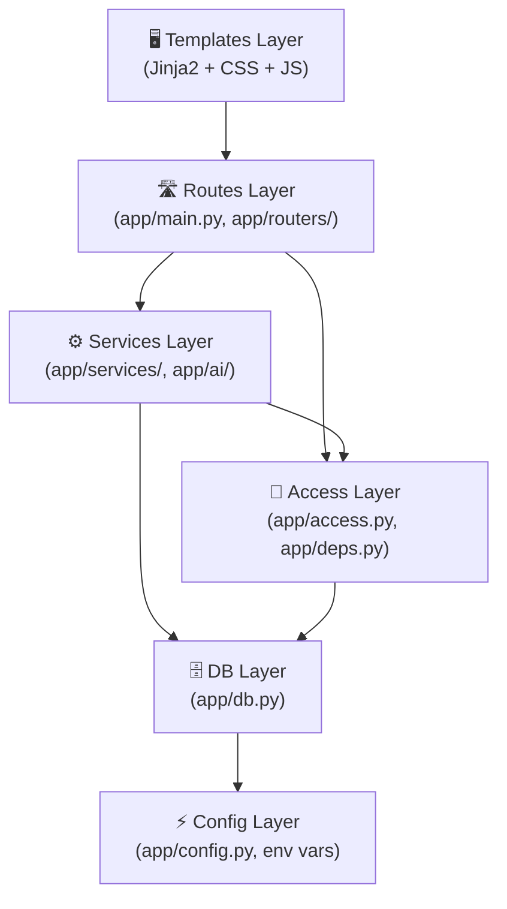
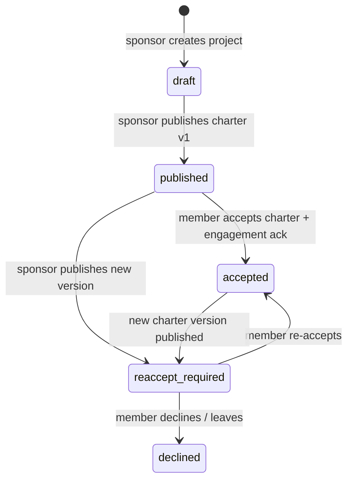
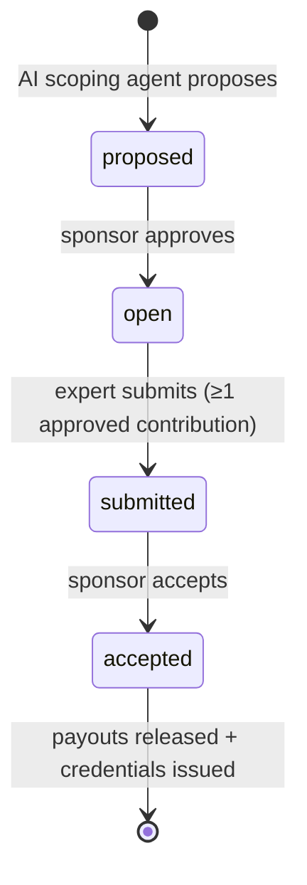
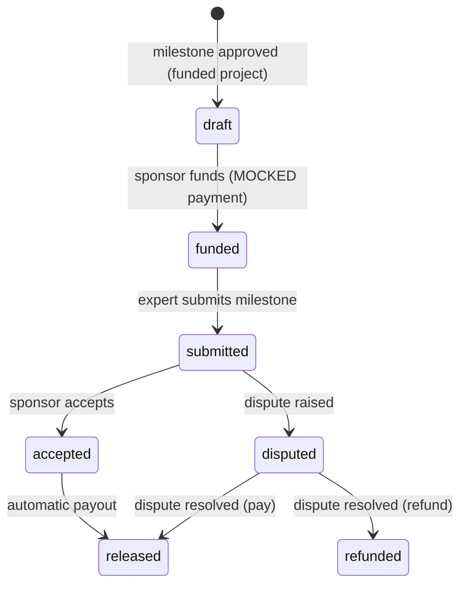
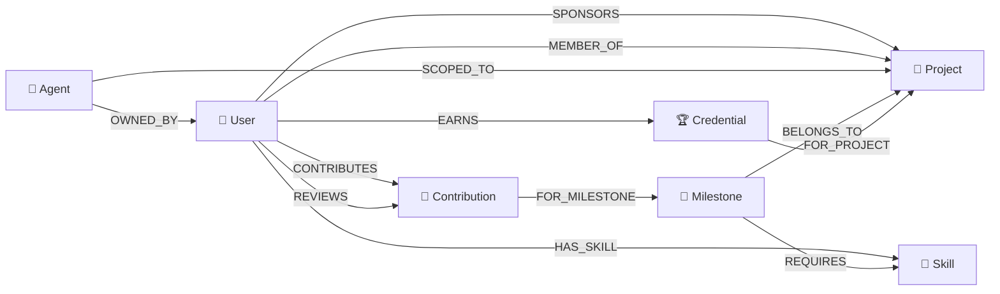

# Architecture

## Layers

| Layer | Responsibility | Key Files |
|-------|---------------|-----------|
| **Config** | Environment variables, feature flags, auth mode | `app/config.py` |
| **DB** | SQLite/Postgres connection, schema init, query helpers | `app/db.py` |
| **Access** | `can_view()`, `membership_state()`, join rules, RBAC | `app/access.py`, `app/deps.py` |
| **Services** | Business logic: projects, escrow, payouts, splits, AI gateway, integrity | `app/services/`, `app/ai/`, `app/integrity/`, `app/splits.py`, `app/ledger.py` |
| **Routes** | HTTP endpoints, form handlers, API routes | `app/main.py`, `app/routers/` |
| **Templates** | Server-rendered HTML, dark theme, Cytoscape.js graphs | `app/templates/`, `app/static/` |

---

## Data Model — 14 Tables

| # | Table | Purpose |
|---|-------|---------|
| 1 | `users` | Synthetic personas with roles, skills, verification levels, conflict orgs |
| 2 | `projects` | Sponsor-posted research problems with engagement model and sensitivity label |
| 3 | `charters` | Versioned project charters (terms JSON + SHA-256 hash) |
| 4 | `charter_acceptances` | Per-user acceptance of a specific charter version + engagement model ack |
| 5 | `milestones` | Deliverables with acceptance criteria, required skills, INR amounts |
| 6 | `agents` | AI agent instances scoped to a project and human owner |
| 7 | `contributions` | Artefacts submitted by members, with AI declaration and similarity score |
| 8 | `ledger_entries` | Append-only tamper-evident hash chain of all state-changing actions |
| 9 | `escrows` | Milestone funding state machine (draft → funded → released) |
| 10 | `payouts` | Per-person payment records with rationale and receipt hash |
| 11 | `reviews` | Expert review decisions on contributions (approve/reject/flag) |
| 12 | `disputes` | Milestone disputes with evidence and resolution |
| 13 | `ai_calls` | Log of every AI gateway invocation (prompt summary, route, approval) |
| 14 | `credentials` | Issued certificates and badges with verifiable credential hash |

---

## State Machines

### Charter Lifecycle

### Milestone Status

### Escrow State Machine

---

## Split Formula

The split engine (`app/splits.py`) uses `fractions.Fraction` for exact arithmetic. All money is integer rupees.

**Given** a milestone amount:

1. **Platform fee** = 10% of amount (rounded half-up)
2. **AI compute reserve** = 5% of amount (rounded half-up)
3. **Net** = amount − fee − AI reserve (= 85% of amount)
4. **Expert pool** = 30% of net (split equally among experts; if none, added to student pool)
5. **Student pool** = net − expert pool
   - **40%** split equally among all students
   - **60%** split proportionally by contribution impact weights
6. **Largest-remainder rounding** ensures `experts + students + fee + reserve == amount` exactly. Ties go to the lowest weight, then lowest user ID.

**Example** — ₹1,00,000 milestone, weights [0.5, 0.3, 0.2], 1 expert:

| Recipient | Amount (INR) |
|-----------|-------------|
| Student 1 (weight 0.5) | ₹25,783 |
| Student 2 (weight 0.3) | ₹18,643 |
| Student 3 (weight 0.2) | ₹15,074 |
| Expert | ₹25,500 |
| Platform fee | ₹10,000 |
| AI compute reserve | ₹5,000 |
| **Total** | **₹1,00,000** |

---

## Graph Model (Neo4j — optional)

7 node types with their relationships:

| Node | Key Properties |
|------|---------------|
| `User` | id, name, role, verification_level, institution |
| `Project` | id, title, engagement_model, sensitivity_label |
| `Milestone` | id, title, amount_inr, status |
| `Contribution` | id, ai_declaration, impact_weight, review_status |
| `Skill` | name |
| `Agent` | id, kind, allowed_tools |
| `Credential` | id, kind, credential_hash |
